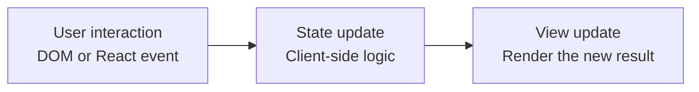

# JS DRUM KIT

**Portfolio project** · A browser-based drum kit controlled with keyboard and mouse interactions.

## Overview

A browser-based drum kit controlled with keyboard and mouse interactions.

## Technology Stack

- `HTML`
- `CSS`
- `JavaScript`

## How the Repository Works

| Stage | Responsibility |
|---|---|
| **User interaction** | DOM or React event |
| **State update** | Client-side logic |
| **View update** | Render the new result |

## Concepts Covered

- Project structure
- Core implementation
- Practical debugging
- Version control
- Incremental experimentation

## Repository Map

- `background.jpg`
- `index.html`
- `script.js`
- `sounds`
- `style.css`

## Recruiter Summary

This repository demonstrates practical implementation skills, repository organization, and an end-to-end understanding of the project workflow. It is suitable as a focused example of applied software or data work.

---

Documentation is concise and project-focused; source code was not modified.
